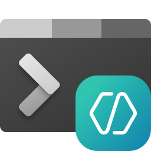
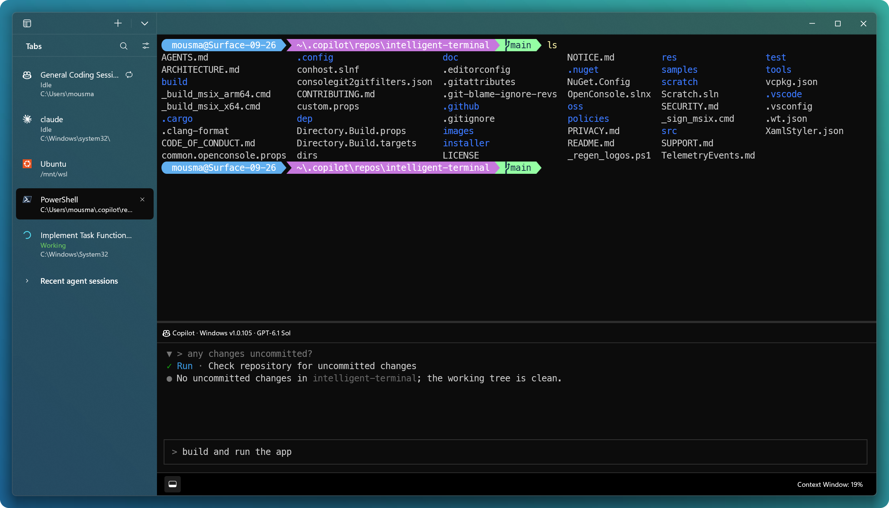
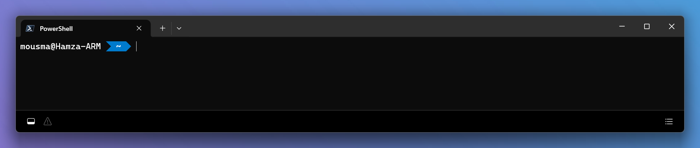
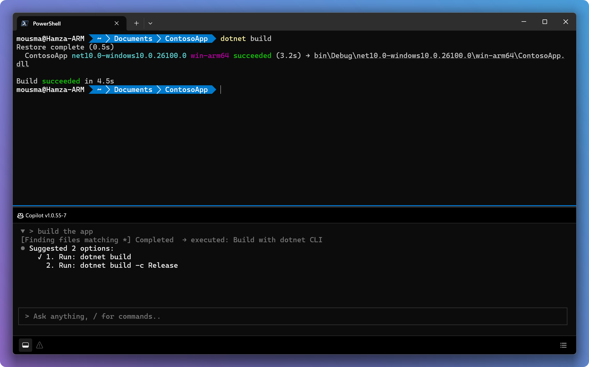
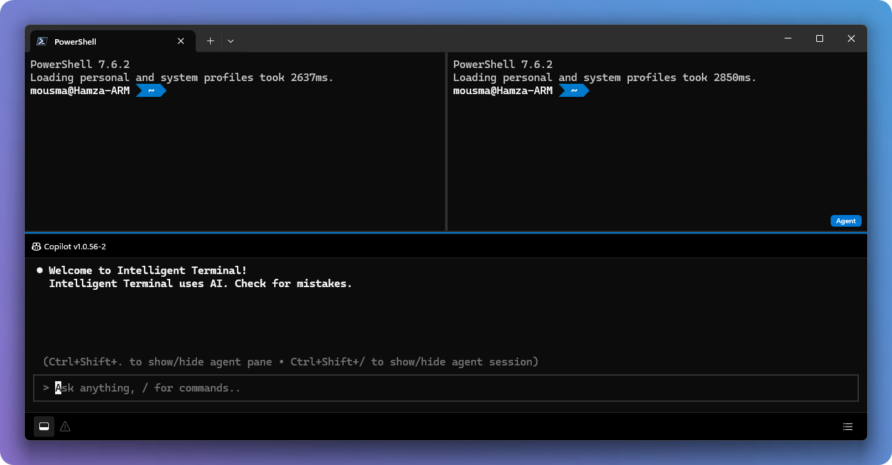
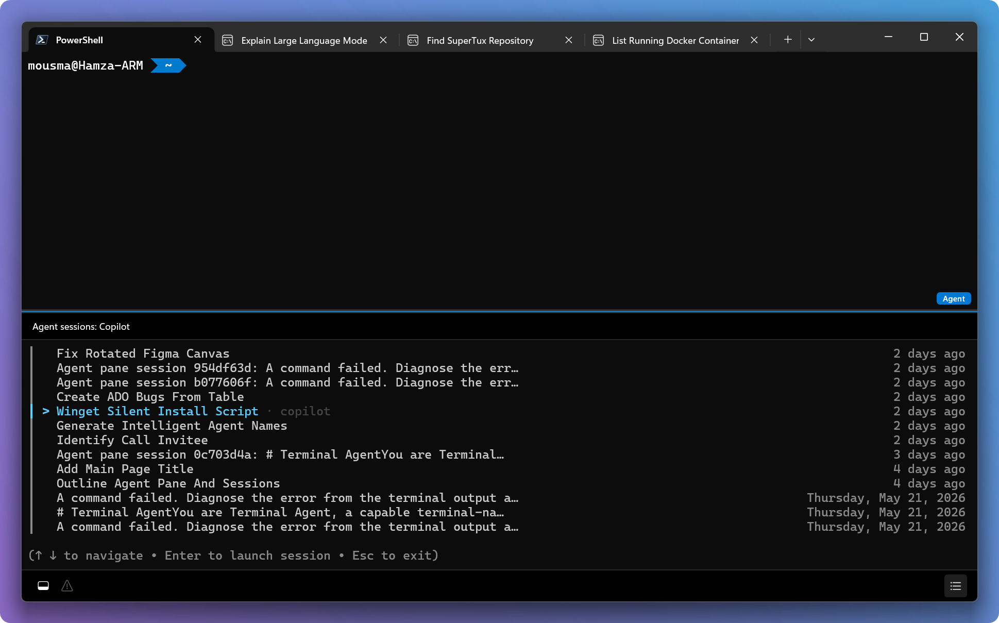
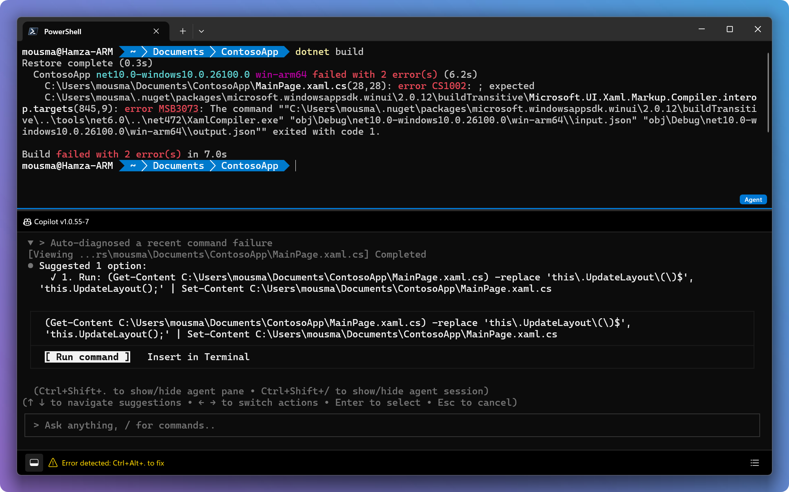
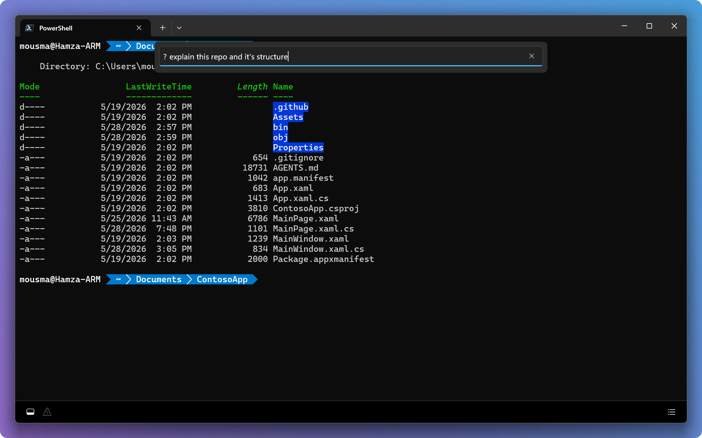
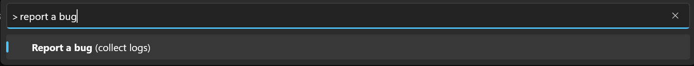

<p align="center">
    <picture>
      
    </picture>
</p>

# Welcome to the Intelligent Terminal repo

<details>
  <summary><strong>Table of Contents</strong></summary>

- [What is Intelligent Terminal?](#what-is-intelligent-terminal)
- [Installing and running Intelligent Terminal](#installing-and-running-intelligent-terminal)
  - [Microsoft Store](#microsoft-store-recommended)
  - [WinGet](#winget)
  - [Downloads](#downloads)
- [Get Started](#get-started)
- [Keyboard Shortcuts](#keyboard-shortcuts)
- [Configuration](#configuration)
- [Features](#features)
  - [Sidebar](#sidebar)
  - [Agent Status Bar](#agent-status-bar)
  - [Agent Pane](#agent-pane)
  - [Agent Management](#agent-management)
  - [Error Detection](#error-detection)
  - [Command Palette](#command-palette)
- [Data & Privacy](#data--privacy)
- [Building the Code](#building-the-code)
- [FAQ](./doc/faq.md)
- [Feedback](#feedback)
- [Contributing](#contributing)
- [Code of Conduct](#code-of-conduct)
- [Security](#security)
- [Trademarks](#trademarks)

</details>

<br />

## What is Intelligent Terminal?

Intelligent Terminal is an experimental fork of [Windows Terminal](https://github.com/microsoft/terminal) with native agent integration.

Intelligent Terminal works with any [Agent Client Protocol (ACP)-compatible](https://agentclientprotocol.com/get-started/agents) agent CLI. All you need is to install your preferred agent CLI on your PC. If you don't have a preferred agent, we'll get you setup with [GitHub Copilot CLI](https://github.com/features/copilot/cli/).

Intelligent Terminal takes all the features you love in Windows Terminal such as:  tabs, profiles, themes, settings, shells, and keyboard shortcuts, which all work the way you expect.

Read the [announcement blog post](https://devblogs.microsoft.com/commandline/announcing-intelligent-terminal-version-0-1/) for more details.

---

## Installing and running Intelligent Terminal

> [!NOTE]
> Intelligent Terminal requires Windows 10 2004 (19041) or later and a supported agent CLI. [GitHub Copilot](https://github.com/features/copilot/cli/) is the default. Account, subscription, and API-key requirements depend on your agent and model provider. Local models are also supported through compatible agents.

### Microsoft Store (recommended)

Install the [Intelligent Terminal from the Microsoft Store](https://apps.microsoft.com/detail/9NMQC2SSJX24).
This allows you to always be on the latest version when we release new builds
with automatic upgrades.

### WinGet

[winget](https://github.com/microsoft/winget-cli) users can download and install
the latest Intelligent Terminal release by installing the `Microsoft.IntelligentTerminal`
package:

```powershell
winget install --id Microsoft.IntelligentTerminal -e
```

### Downloads

| Distribution | Architecture | Link |
|--------------|:------------:|------|
| App Installer | x64, arm64, x86 | [Download](https://github.com/microsoft/intelligent-terminal/releases/latest) |


---

## Get Started

1. On first launch, choose your agent. Intelligent Terminal auto-detects several [ACP-compatible](https://agentclientprotocol.com/get-started/agents) agents on your machine (Copilot/Claude/Codex/Gemini/OpenCode/Antigravity). If no agents are found, it defaults to GitHub Copilot CLI and installs it for you via WinGet.
2. If you aren't already authenticated, the agent pane walks you through sign-in. For GitHub Copilot Enterprise, press <kbd>E</kbd> at the sign-in prompt and enter your enterprise host (for example, `your-org.ghe.com`); the last host you used is remembered.
3. Start asking questions and using the agent pane for assistance. The agent has context on your shell output, no copy-pasting needed. The agent pane does not run commands in your shell without your explicit approval: you choose whether to run its suggested command, copy it into your shell to run yourself, or dismiss it.

> [!TIP]
> If you see "running scripts is disabled on this system" or an `UnauthorizedAccess` error in PowerShell, your execution policy is blocking your profile and Intelligent Terminal can't initialize shell integration. Run:
> ```powershell
> Set-ExecutionPolicy -Scope CurrentUser -ExecutionPolicy RemoteSigned
> ```
> If you run into any other issues or dependency errors, see [installing-dependencies.md](./doc/installing-dependencies.md).

---

## Keyboard Shortcuts

All shortcuts are customizable through Intelligent Terminal settings.

| Shortcut | Action |
|----------|--------|
| <kbd>Ctrl+Shift+.</kbd> | Toggle the agent pane |
| <kbd>Ctrl+Shift+I</kbd> | Switch focus to/from the agent pane |
| <kbd>Ctrl+Alt+.</kbd> | Open agent pane with error context |
| <kbd>Ctrl+Shift+/</kbd> | Open agent management |
| <kbd>Ctrl+Shift+S</kbd> | Show or hide the sidebar |
| <kbd>Ctrl+Shift+G</kbd> | Toggle the sidebar's Agents-only filter |
| <kbd>Alt+Shift+/</kbd> | Open Command Palette in prompt mode |
| <kbd>Alt+Shift+B</kbd> | Open an interactive delegate-agent tab with no startup prompt |
| <kbd>Alt+V</kbd> | Paste a clipboard image into the agent pane |

---

## Configuration

Configure agent features under **Settings > Agents**. The agent pane and command palette have separate agent selections.

| Setting | Options | Shortcut / command |
|---------|---------|--------------------|
| Agent | Choose the agent for the agent pane. GitHub Copilot is the default; other built-in agents and custom ACP-compatible commands are supported. | `/agent` |
| Model | Choose the agent pane's model. Configure agent-provided session options or select a configured BYOK model for the current pane. | `/config`, `/model` |
| Custom endpoint or local model | Add an OpenAI-compatible Chat Completions endpoint for GitHub Copilot or OpenCode, with a Base URL, Model ID, and optional API key. Keys are stored in Windows Credential Manager. Keyless local endpoints such as Ollama are supported. | `/model` to select an added model |
| Pane position | Top, Bottom (default), Left, or Right. | `/move left\|right\|up\|down` |
| Error detection | **Off**, **Detect errors** (default), or **Detect and fix errors**. Detect errors stays local; Detect and fix errors automatically sends failure context to your agent for suggested fixes. | <kbd>Ctrl+Alt+.</kbd> to analyze an error; `/fix` for manual diagnosis |
| Sessions | Track running agents and sessions that need your attention. Enabled by default. | <kbd>Ctrl+Shift+/</kbd> or `/sessions` to open agent management |
| Token usage | Show remaining context and session cost when your agent reports them. Enabled by default. | |
| Markdown formatting | Format agent replies after streaming stops, including replies loaded from saved history. Enabled by default. | |
| Automatic approval | Let the agent run with the full permissions its CLI provides. Off by default; availability depends on the agent and organization policy. Terminal action cards still require your confirmation. | |
| Command palette > Agent CLI | Choose the agent used for command-palette delegation and new interactive delegate tabs. | <kbd>Alt+Shift+/</kbd> to open agent prompt mode; <kbd>Alt+Shift+B</kbd> for a new interactive agent tab |

These shortcuts open or use the feature; they don't toggle its setting. All key bindings are customizable.

You can also pin a specific agent to a profile. Open a profile in Settings (for example, "PowerShell" or "Ubuntu") and set the agent you want its agent pane to use. For a WSL profile, the picker also lists agents installed inside that distro, so an Ubuntu profile can run a Linux-side agent. Profiles you don't configure keep using the global agent.

Installed Windows agent CLIs also appear as individual profiles in the new-tab dropdown, alongside shells and with their own agent icons. These launch the agent's native interactive interface, independently of the built-in agent pane. Configure their working directory, appearance, and supported agent options in the profile editor. To change the default split target, edit the profile's `defaultSplitProfile` in `settings.json`; this setting is not available in the profile editor. See [Native agent profiles](doc/agent-profiles.md).

Google Antigravity is supported in the agent pane on Windows and inside WSL.
With the `agy` CLI installed in the selected source, Intelligent Terminal automatically
downloads and prepares the supported ACP server when you connect or load its models
in Settings. You can also install ACP manually.
See [Antigravity setup](./doc/installing-dependencies.md#google-antigravity-acp-windows-and-wsl).

Authentication, model selection, and permission modes are provided through ACP.
Interactive delegation and shell-session hooks use the `agy` CLI.
ACP and CLI conversations have separate resume paths; ACP does not list the CLI's
cold-start history.

When **Settings > Agents > Sessions** is off, session management shows a subtle reminder below its title to turn it on for the best experience. Existing hooks are not removed and may continue to report activity; the setting controls their installation and updates. The reminder disappears when Sessions is enabled and is not shown when organization policy prevents enabling it.

---

## Features

### Sidebar

<p align="center">
  
</p>

Manage terminal tabs and agent sessions from the sidebar. Press <kbd>Ctrl+Shift+S</kbd>
to show or hide it. Use the sidebar's display-options menu to filter agent tabs and show recent agent sessions.

- **Tabs** shows your terminal tabs, with display options for details such as working directory, Git branch, and agent status.
- **Agents only** filters open tabs to agent tabs. Press <kbd>Ctrl+Shift+G</kbd> to toggle this filter.
- **Search** finds open tabs and recent agent sessions, including items hidden by the current display filters.
- **Recent agent sessions** lets you return to supported conversations. Collapse the section to hide its rows without closing agents or deleting sessions.

To return to horizontal tabs, right-click a tab and change the tab layout.

### Agent Status Bar

<p align="center">
  
</p>

The agent status bar sits at the bottom of the window. On the left are the agent pane toggle (<kbd>Ctrl+Shift+.</kbd>) and the error detection icon (<kbd>Ctrl+Alt+.</kbd>), which lights up when a fixable error is detected.

In horizontal tab mode, the sessions icon appears at the bottom right and opens agent management (<kbd>Ctrl+Shift+/</kbd>). In sidebar mode, this icon is hidden; use the sidebar's **Recent agent sessions** section instead.

The status bar can also display your remaining context and session cost when available; toggle this on or off in **Settings > Agents > Token usage**.

### Agent Pane

<p align="center">
  
</p>

A context-aware, docked pane with your agent CLI of choice. The pane has context on your shell output across all your shells (PowerShell, Bash/WSL). Toggle with <kbd>Ctrl+Shift+.</kbd>, switch focus with <kbd>Ctrl+Shift+I</kbd>. If the agent needs to do multiple or complex tasks, it spins up background tasks in new tabs so your active shell stays focused. When the agent suggests a shell command, the pane gives you the option to run or copy it rather than running it automatically. Paste a clipboard image straight into the chat with <kbd>Alt+V</kbd> to show the agent a screenshot, diagram, or mockup (acting on the image depends on your agent's image support).

<p align="center">
  
</p>

When you have multiple panes active, a small "Agent" indicator will appear on the pane that your agent has "focus" on.

Inside the pane you can scroll and drag to select with the mouse, double-click a word or triple-click a line, and press <kbd>Ctrl+C</kbd> to copy. Press <kbd>Up</kbd> and <kbd>Down</kbd> in the input to recall recent prompts.

#### Slash Commands

Inside the agent pane, type `/` to see available commands. Type `/help` at any time to show the list.

| Command | Description |
|---------|-------------|
| `/agent [id]` | Pick the agent source for this tab. In a WSL pane, the picker includes agents installed on Windows and in that pane's WSL distro; it never offers other distros. |
| `/clear` | Clear the chat scrollback (keeps the current session) |
| `/config` | Configure the current agent session using the options your agent exposes. With GitHub Copilot, for example, you can set the mode (agent, plan, or autopilot), model, reasoning effort, and whether it asks for approval before using tools |
| `/fix [hint]` | Diagnose the active terminal and suggest a fix; add an optional hint to steer it (e.g. `/fix the path looks wrong`) |
| `/help` | Show the command list |
| `/model [id]` | Pick the model for this pane; bare `/model` opens a picker of your configured BYOK models, `/model <id>` switches directly |
| `/move [position]` | Move this tab's agent pane without changing the global setting or other tabs; `/move left\|right\|up\|down` (aliases `l`/`r`/`u`/`d`) |
| `/new` | Start a fresh agent session (drops history) |
| `/restart` | Restart the agent with a clean session |
| `/sessions` | Open agent management (same as <kbd>Ctrl+Shift+/</kbd>) |
| `/stop` | Cancel the in-flight prompt |

#### Custom Providers (BYOK)

Run your agent against your own provider or a model on your machine. BYOK is supported through GitHub Copilot and OpenCode using an OpenAI-compatible Chat Completions endpoint. Under Agents settings, add a provider with a Base URL, Model ID, and optional API key, then pick it from the `/model` picker (configured models show as `modelId (BYOK)`). API keys are stored in Windows Credential Manager; a local Ollama model still works with no key:

```text
Base URL:  http://localhost:11434/v1
Model ID:  <your local model>
API key:   <optional>
```

### Agent Management

<p align="center">
  
</p>

View all active agents, their status, and past sessions. Pick up a workflow where you left off or check on a long-running task. In horizontal tab mode, click the sessions icon at the bottom right or press <kbd>Ctrl+Shift+/</kbd> to open agent management. In sidebar mode, use **Recent agent sessions**.

While a tracked built-in agent session is live, its terminal pane uses the agent's icon. Vertical pane rows show their own icons; tab headers in both layouts follow the focused terminal pane. Focusing the AI helper keeps its associated terminal pane as the source. When the session ends, or the provider is custom or unknown, the profile icon is used instead. This works whether or not Agent status is selected as visible tab metadata.

Sidebar tab metadata, including Agent status, follows the same terminal source. Focusing the AI helper does not replace it with the helper's status, and the terminal's status continues updating while you use the helper.

### Error Detection

<p align="center">
  
</p>

When a command fails, an indicator appears in the agent status bar. Click it or press <kbd>Ctrl+Alt+.</kbd> to open the agent pane with the error context already loaded. The agent can explain what happened and suggest or run a fix. Configure your settings to auto-detect errors only, or to also auto-suggest fixes. You can also trigger a fix at any time from the agent pane with the `/fix` slash command.

### Command Palette

<p align="center">
  
</p>

Type `?` followed by your prompt in the Command Palette to kick off an agent task. Intelligent Terminal injects context from the active pane and starts the agent in a background tab. Use <kbd>Alt+Shift+/</kbd> to jump directly into prompt mode.

---

## Data & Privacy

Intelligent Terminal is a **local transport layer**. It passes your prompts and shell context to your selected agent CLI over stdio/ACP. Intelligent Terminal does not call any cloud APIs itself and does not persist conversation history, however, diagnostic logs may be written to disk and telemetry may be emitted as described below.

### What data flows through Terminal

- Your prompts (what you type in the agent pane or command palette)
- Shell output context (recent command output shared with the agent for context)
- Basic environment metadata (shell type, OS version)

All of this is held in memory for the active session only and discarded when the session ends.

### Where your data goes depends on your agent CLI

| Agent CLI | Data routing | Terms |
|-----------|--------------|-------|
| [GitHub Copilot](https://github.com/features/copilot/cli/) (default) | GitHub backend | [GitHub Copilot Trust Center](https://resources.github.com/copilot-trust-center/). Enterprise protections (e.g., zero data retention) apply for eligible plans. |
| Third-party or custom agent CLIs | Determined by the agent vendor | Governed by that vendor's terms, not Microsoft or GitHub agreements. |

> [!NOTE]
> Terminal cannot guarantee data protections for third-party agent CLIs. When you select an agent, you're choosing where your data goes. Review your agent vendor's privacy policy before use. For more information on how to use GitHub Copilot responsibly, see [Responsible use of GitHub Copilot](https://docs.github.com/en/copilot/responsible-use/copilot-in-windows-terminal).

### Controls

- Choose your agent CLI at any time in Settings > Agent
- Disable auto error detection to prevent shell output from being detected automatically
- Intelligent Terminal always asks before running commands on your behalf in your shell

Intelligent Terminal only collects usage data and sends it to Microsoft to help improve our products and services. Read our [privacy statement](https://go.microsoft.com/fwlink/?LinkID=824704) to learn more. See [PRIVACY.md](./PRIVACY.md) for details and instructions on how to disable telemetry.

### Data Collection

The software may collect information about you and your use of the software and send it to Microsoft. Microsoft may use this information to provide services and improve our products and services. You may turn off the telemetry as described in the repository. There are also some features in the software that may enable you and Microsoft to collect data from users of your applications. If you use these features, you must comply with applicable law, including providing appropriate notices to users of your applications together with a copy of Microsoft's privacy statement. Our privacy statement is located at https://go.microsoft.com/fwlink/?LinkID=824704. You can learn more about data collection and use in the help documentation and our privacy statement. Your use of the software operates as your consent to these practices.

---

## Building the Code

Building Intelligent Terminal is the same as building Windows Terminal. See the [Developer Guidance](https://github.com/microsoft/terminal#developer-guidance) section of the Windows Terminal README for prerequisites, build instructions, and debugging steps.

---

## Feedback

Intelligent Terminal is in an experimental stage. If you have a feature request or find a bug, [submit an issue](https://github.com/microsoft/intelligent-terminal/issues) on the GitHub repository.

### Collecting Logs

To help us investigate bugs, please collect and attach diagnostic logs when filing an issue:

1. Open Command Palette with <kbd>Ctrl+Shift+P</kbd>
2. Search for **Report a bug (collect logs)**

<p align="center">
  
</p>

3. A ZIP file containing your error logs will be generated and opened in File Explorer
4. Attach the ZIP to your issue so we can investigate with full context

Intelligent Terminal ships as a separate app and installs next to your existing Windows Terminal. If you don't want agents in your terminal, nothing changes for you. With this model, we can learn, experiment, and iterate with you, the community, on what this evolution might look like without breaking your existing Windows Terminal flows.

---

## Contributing

We are excited to work alongside you, our amazing community, to build and enhance Intelligent Terminal!

**Before you start work on a feature/fix**, please read & follow the [Windows Terminal Contributor's Guide](https://github.com/microsoft/terminal/blob/main/CONTRIBUTING.md). The contribution process is the same.

For local dev/build of this repo, see:
[quick-start-local-dev](doc/quick-start-local-dev.md)

---

## Code of Conduct

This project has adopted the [Microsoft Open Source Code of Conduct](https://opensource.microsoft.com/codeofconduct/). For more information, see the [Code of Conduct FAQ](https://opensource.microsoft.com/codeofconduct/faq/) or contact [opencode@microsoft.com](mailto:opencode@microsoft.com) with any additional questions or comments.

---

## Security

If you believe you have found a security vulnerability in this repository, please report it following the instructions in [SECURITY.md](./SECURITY.md).

---

## Trademarks

This project may contain trademarks or logos for projects, products, or services. Authorized use of Microsoft trademarks or logos is subject to and must follow [Microsoft's Trademark & Brand Guidelines](https://www.microsoft.com/en-us/legal/intellectualproperty/trademarks/usage/general). Use of Microsoft trademarks or logos in modified versions of this project must not cause confusion or imply Microsoft sponsorship. Any use of third-party trademarks or logos is subject to those third-party's policies.
