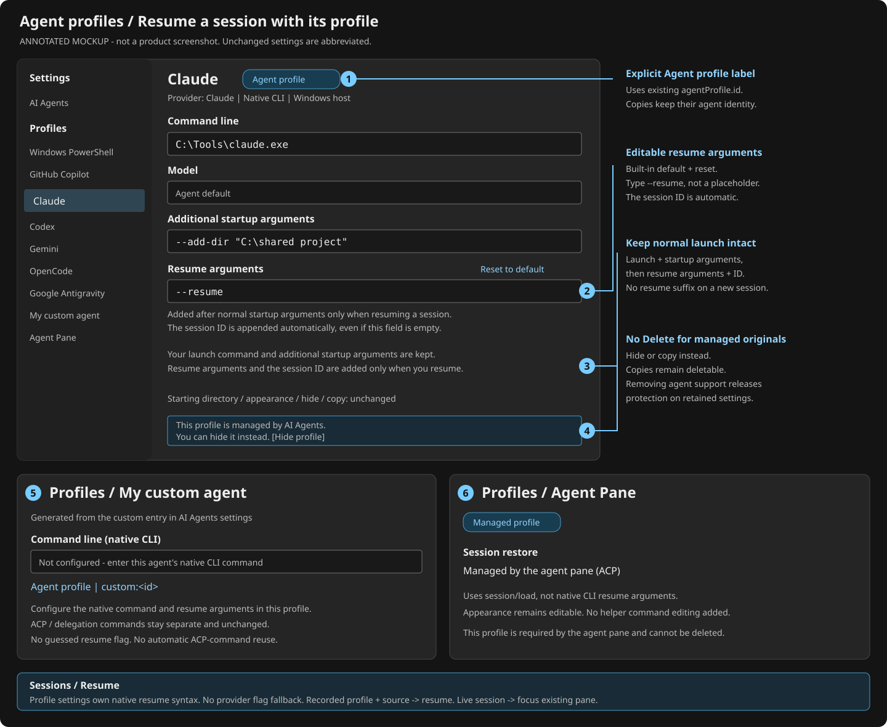

# Resume sessions with their agent profile

Feature contract and annotated mockup for the implementation in this PR.
Validation results and any remaining blockers are recorded in the PR body.

Previously, editing an agent profile did not reliably affect how a historical
session reopened. Generated agent profiles could also be deleted, and agents
added in AI Agents settings did not receive corresponding profiles.



## Proposed UI and behavior

| Annotation | Change |
| --- | --- |
| 1 | Show an explicit **Agent profile** badge and provider name. Use existing `agentProfile.id` identity, not the editable display name. The separate managed-original protection message explains why Delete is unavailable; a user-created agent-profile copy still has the badge but remains deletable. |
| 2 | Add **Resume arguments** below additional startup arguments. Enter only the argument or verb, such as `--resume` or `resume`. Hint: **Added after the normal startup arguments only when resuming a session. The session ID is appended automatically.** No placeholder input and no command preview. Built-ins inherit profile defaults with reset/inheritance affordances; an empty override adds the ID positionally with no resume prefix. |
| 3 | The help text explains composition: **Your launch command and additional startup arguments are kept. Resume arguments and the session ID are added only when you resume a session.** This is explanatory text, not another control. |
| 4 | Replace Delete with **This profile is managed by AI Agents. You can hide it instead.** Keep appearance, hide, and copy controls. Protect the managed original, not user-created copies. |
| 5 | Each custom agent saved in AI Agents gets one corresponding managed profile. Configure its native CLI using that profile's existing **Command line** setting and its **Resume arguments**. No second custom-agent editor or duplicate native-command setting is needed; an ACP command is not assumed to be an interactive CLI command. |
| 6 | Protect the existing **Agent Pane** profile too. Show **Session restore: Managed by the agent pane (ACP)** instead of native resume arguments. Do not expose helper pipes, window IDs, or native startup flags here. |

These are additions to the current profile page, not a replacement settings UI.
The mockup abbreviates unchanged controls. "Resume" means reopen a particular
conversation; it does not mean always resume the latest session on ordinary
new-tab launch, splitting, or when Sessions is off.

## Launch contract

Proposed inheritable profile key: `agentProfile.resumeArguments`.
Store only the arguments preceding the session ID, not a template, second
executable, shell script, or conversation ID:

```jsonc
{
    "agentProfile.id": "claude",
    "agentProfile.model": "",
    "agentProfile.arguments": "--add-dir \"C:\\shared project\"",
    "agentProfile.resumeArguments": "--resume"
}
```

An omitted value inherits the profile default. An explicit empty string adds
the session ID positionally, without a resume flag/verb, for both built-in and
custom profiles. It does not disable resume. The UI shows the automatic-ID hint
beside the field; users never type `{sessionId}`. Parse resume arguments using the same
argument rules as additional startup arguments, then append the validated,
opaque session ID as one argument. Use the existing executable/batch/WSL quoting
helpers; never evaluate arguments as script text. Malformed or unsafe arguments
produce a launch-time error.

| Built-in provider | Default resume arguments (current repository contract) |
| --- | --- |
| GitHub Copilot | `--resume` |
| Claude | `--resume` |
| Codex | `resume` |
| Gemini | `--resume` |
| OpenCode | `--session` |
| Google Antigravity | `--conversation` |
| Custom agent | Empty until configured; never guess built-in syntax |

These defaults reflect `tools/wta/src/agent_registry.rs:130-294`, not a claim that
every installed CLI version has been live-verified. Implementation must check
the supported CLI versions, including option ordering and adapter/native history
compatibility. Antigravity currently cannot resume ACP conversations via its CLI.

### One launch command, with a resume-only suffix

```text
Normal launch = profile launch command + additional startup arguments
Resume        = the same normal launch + profile resume arguments + session ID
```

The managed launch command includes the resolved executable and existing
structured model/permission options. Additional startup arguments are included
exactly once. Resume adds only the suffix; an ordinary new tab or split never
receives it. For example, the profile above launches
`claude --add-dir "C:\shared project"` normally, and
`claude --add-dir "C:\shared project" --resume <actual-session-id>` on resume.
Codex uses the identical composition with profile value `resume`, not a
provider-specific branch. Verify supported CLI option ordering with executable
fixtures and live CLI help before implementation ships.

Terminal owns effective profile resolution and this generic composition.
Resolve the profile's executable again at launch; preserve model, permission
mode, extra arguments, environment, appearance, and close-on-exit behavior.
Resume selection belongs in the resume field, not additional startup arguments;
do not add a per-provider flag parser to guess user intent.

### Generation provides defaults; restore reads the effective profile

The six defaults above may stay hardcoded in profile generation, alongside
existing provider defaults. Set `AgentProfileResumeArguments` when generating
each profile and layer user overrides through the normal settings mechanism.
No new configuration file or parallel identity system is needed. The important
change is at restore: read the effective profile value instead of selecting
resume syntax again from the provider ID.

Host-native profile resume in Sessions, sidebar activation and saved-layout
restoration reads the effective profile. A missing profile or native command
reports unavailable; do not silently select a different flag from the provider ID.
ACP `session/load` stays a separate capability. Legacy WSL launches remain on
their existing source-qualified route because automatic native profile
generation currently covers the Windows host, not WSL installations. This
feature must not change that route or claim WSL profile generation.

For built-ins, an explicit profile `commandline` remains an override: use that
base command unchanged as normal launch already does, and do not resurrect hidden structured
model/permission/extra arguments. Resume adds the effective profile resume
arguments and automatic ID to that same base. The profile owner must configure
arguments appropriate to an edited command; no runtime provider-based
replacement occurs. Existing explicit new-tab/action overrides keep their
precedence. This does not change existing built-in command-override behavior.
Custom profiles instead use the explicitly configured native command as their
base and keep their structured model and additional startup arguments active.

For custom agents, generate a stable profile for each canonical `custom:<id>`
across the saved ACP/delegation entries, deduplicating only identical IDs.
Use the generated profile's existing **Command line** field for the native
interactive command; leave it unconfigured initially. Do not introduce a second
command field or redesign AI Agents settings. An unconfigured native launch
must report the missing command explicitly.
Do not run an ACP server or a prompt-bearing delegation command as a native TUI.
Changing/removing a custom command must reconcile its existing command-derived
identity explicitly; do not silently attach an old profile to a different agent.

## Matching sessions and profile lifetime

Reuse the originating profile GUID already known by the Terminal pane/connection
alongside the existing qualified session identity (provider, host/WSL distro,
and session universe). Forward it through the existing resume request where
available. Do not redesign the session registry or persistence format just to
select a profile. Validate provider and execution location; never match by
display name or command-string heuristics. User-created project-profile copies
must remain distinguishable.

The live-pane association is not a durable session-to-profile record. Once its
pane is closed, host history without a profile GUID uses the generated original,
not an arbitrary project-profile copy.

For imported host history with no profile GUID, resolve the corresponding
generated profile by provider identity. If the matching profile or its native
command is unavailable, report an actionable error; never launch a default
shell or silently resume through a different profile. Legacy WSL history keeps
its exact distro and Linux cwd on the existing WSL route; never substitute a host
executable path or Windows environment.
Unavailable stored directories retain the existing reported fallback to the
selected profile's directory.

Live sessions still focus their existing pane. ACP-origin sessions retain
capability-gated `session/load`, the selected provider/source/model, and the
protected Agent Pane profile. Native resume arguments cannot override ACP loading
or make a native-only custom agent ACP-capable. Hook availability does not gate
history listing or resume.

Protect generated originals while their built-in provider remains supported or
their custom agent remains configured. Missing executables and policy blocks
make them unavailable, not deletable or silently replaced. Removing support or
deleting the custom-agent entry releases protection on retained orphaned settings;
do not discard overrides automatically. The internal Agent Pane profile remains
protected independently. Enforce this in the delete handler as well as the UI,
and reconcile old generated-profile deletion tombstones so supported originals
return with their overrides intact. User-created copies remain deletable.

## Keep the existing launch protocol

`CreateTab` and `CreateAgentCliTab` already accept profile and command line;
`wtcli new-tab -p` forwards the profile selection. Reusing these does not require
a new COM method, versioned interface, transport, or launch-result protocol.
Passing a profile GUID alone selects settings, but does not tell Terminal which
conversation to resume. Carry the known session ID with the existing internal
resume request, resolve/build the effective profile launch in Terminal, and use
the current creation path and result/error handling. Keep ACP loading separate.

Evidence: `src/tools/wtcli/main.cpp:842-862`,
`src/cascadia/WindowsTerminal/TerminalProtocolComServer.cpp:994-1055`, and
`src/cascadia/TerminalApp/TerminalPage.Protocol.cpp:768-833`.
The existing internal resume event already dispatches to the target window's
`OnResumeInNewAgentTabRequested`; extending internal handling is not a public
launch protocol redesign.

## Metadata must initialize immediately, with or without hooks

This is an acceptance requirement, not a request to rebuild the metadata system.
Keep the current order: profile/provider identity is available at control/core
creation, launch-derived metadata is published immediately, then hook/registry
updates enrich it. Do not wait for hook registration, the first hook, history
scan, ACP readiness, or a master snapshot before showing the initial provider,
Idle state, and resolved launch directory where the current pipeline supplies
them. Do not fabricate conversation IDs for ordinary new sessions.

The current source explicitly protects this:
`src/cascadia/TerminalApp/TerminalPage.cpp:17753-17761` seeds identity before
control setup; `:13423-13450` supplies launch metadata without hooks.
That fast fallback currently checks `UsesManagedAgentCommand()`. A naive resume
command override can lose that flag, so profile-owned resume must preserve a
trusted profile-launch receipt without labeling arbitrary shell commands as
managed. Keep the existing connection/content identity and ownership guards.

| Scenario | Required behavior |
| --- | --- |
| Hooks installed, before the first event | Same immediate launch metadata as today; no hook wait added. |
| Hooks absent, delayed, broken, or listener unavailable | Same initial values and normal chat/list/resume behavior; only hook-dependent live enrichment may be unavailable, as today. |
| Hooks arrive after initial metadata | Update the same pane/session through existing ownership rules; do not create duplicates or rebind another conversation. |
| Sessions ON/OFF, master/receiver reconnect | Preserve existing status reduction and receiver fences; do not infer conversation IDs from command strings. |
| Resume, restart, split, move between windows | Preserve launch metadata initialization and correct tab/window/content routing; do not replay stale status into a new lifetime. |

Extend the existing
`TabTests::ManagedProfileLaunchMetadataDoesNotWaitForHooks`,
`ManagedProfileLaunchMetadataSurvivesTrackingModeChanges`, and
`ManagedProfileLaunchMetadataReceiptSurvivesWindowTransfer` cases for profile-owned
resume. UI tests must inspect initial values before any hook/snapshot, then the
downstream tab values after enrichment. No new polling loop or fixed delay.

## Required implementation files

Every path below is relative to the repository root. This is the future runtime
implementation map. The annotated SVG is a mockup, not runtime evidence.

| Layer | Exact files | What changes / why |
| --- | --- | --- |
| Generated defaults | `src/cascadia/TerminalSettingsModel/AgentProfileGenerator.cpp` | Set built-in resume defaults during generation; restore reads the effective profile instead of choosing a flag again. No separate defaults file required. |
| Profile setting / schema | `src/cascadia/TerminalSettingsModel/MTSMSettings.h`; `src/cascadia/TerminalSettingsModel/Profile.idl`; `doc/cascadia/profiles.schema.json` | Add the inheritable string, automatic-ID help, and empty/reset semantics. Existing profile macros project/serialize it. |
| Generic launch assembly | `src/cascadia/inc/AgentProfileUtils.h` | Reuse normal launch assembly; append parsed effective resume arguments and the quoted ID only for resume intent. No provider-to-resume-flag branch. |
| Generated/custom profile lifecycle | `src/cascadia/TerminalSettingsModel/AgentProfileGenerator.cpp`; `src/cascadia/TerminalSettingsModel/AgentProfileGenerator.h`; `src/cascadia/TerminalSettingsModel/CascadiaSettingsSerialization.cpp`; `src/cascadia/TerminalSettingsModel/CascadiaSettings.cpp` | Reconcile custom entries after settings load, preserve GUIDs/overrides, restore previously suppressed supported originals, and expose shared managed-original eligibility. |
| Profile editor / delete handler | `src/cascadia/TerminalSettingsEditor/Profiles_Base.xaml`; `src/cascadia/TerminalSettingsEditor/ProfileViewModel.cpp`; `src/cascadia/TerminalSettingsEditor/ProfileViewModel.h`; `src/cascadia/TerminalSettingsEditor/ProfileViewModel.idl`; `src/cascadia/TerminalSettingsEditor/MainPage.cpp` | Bind resume arguments and hints/reset, omit preview, show protection, and enforce it in deletion. Copies stay deletable. |
| Custom native command (reuse) | `src/cascadia/TerminalSettingsModel/AgentProfileGenerator.cpp`; `src/cascadia/TerminalSettingsEditor/Profiles_Base.xaml` | Generate the custom profile and use its existing Command line control. No duplicate command field in AI Agents settings. |
| UI resource source | `src/cascadia/TerminalSettingsEditor/Resources/en-US/Resources.resw` | Add accessible agent-profile label and automatic-ID hint; propagate translations through the existing localization workflow. |
| Both host history activation callers | `tools/wta/src/app.rs`; `tools/wta/src/master/mod.rs`; `tools/wta/src/session_mgmt.rs`; `tools/wta/src/shell/wt_channel/cli_channel.rs` | Sessions/sidebar send the existing internal resume request with profile/session identity. Terminal resolves effective settings instead of callers assembling host resume commands. Keep separate ACP/legacy WSL behavior. |
| Existing profile/session binding | `src/cascadia/TerminalApp/TerminalPage.cpp`; `src/cascadia/TerminalApp/TerminalPage.h` | Reuse the pane's known profile GUID and qualified session identity in existing resume handling. Avoid a registry/persistence redesign solely for profile selection. |
| Existing launch boundary (reuse, not redesign) | `src/cascadia/TerminalApp/TerminalPage.Protocol.cpp`; `src/cascadia/TerminalApp/TerminalPage.cpp` | Resolve profile-owned resume before the existing profile-aware creation call. Existing `CreateTab`/`CreateAgentCliTab`, COM interface and `wtcli -p` stay unchanged. |
| Fast initial metadata (preserve) | `src/cascadia/TerminalApp/TerminalPage.cpp`; `src/cascadia/TerminalApp/ContentManager.cpp`; `src/cascadia/TerminalSettingsAppAdapterLib/TerminalSettings.cpp`; `src/cascadia/LocalTests_TerminalApp/TabTests.cpp` | Preserve trusted managed-profile launch information on resume and identity-before-control-setup order; test initial values without hooks and later enrichment. No pipeline rewrite. |
| Saved-layout restoration | `src/cascadia/TerminalSettingsModel/ActionArgs.h`; `src/cascadia/TerminalSettingsModel/ActionArgs.idl`; `src/cascadia/TerminalApp/TabManagement.cpp`; `src/cascadia/TerminalApp/TerminalPage.cpp` | Add one optional saved-action `nativeAgentSessionId` field so profile-owned restore can re-resolve settings. No session-store redesign or public COM change; keep legacy layouts readable. |
| Regression coverage | `src/cascadia/UnitTests_SettingsModel/CustomAgentAndPolicyTests.cpp`; `src/cascadia/UnitTests_SettingsModel/TerminalSettingsTests.cpp`; `src/cascadia/LocalTests_TerminalApp/TabTests.cpp`; `tools/wta/src/app_tests.rs`; `tools/wta/src/master/tests.rs`; `tools/wta/src/coordinator.rs` | Assert normal versus resume argv, data-default overrides, custom lifecycle/protection, both activation routes, and restart/WSL identity. |
| Live coverage / user docs | `test/e2e/tests/Feature.AgentProfileResume.Tests.ps1`; `test/e2e/fixtures/Mock-NativeProfileResume.cmd`; `test/e2e/fixtures/Mock-NativeProfileResume.ps1`; `doc/release-check-list.md`; `test/e2e/README.md`; `doc/agent-profiles.md` | Verify profile routing, captured launch arguments and the Settings UI; map C501-C503 to the release checklist and document automatic session ID. |

## Implementation acceptance

Use executable fixtures to capture argv, environment, profile GUID, and cwd for
all six built-ins plus one custom agent. Assert additional startup arguments
appear once in both normal and resume launches, with resume arguments and the
automatic ID present only in resume. Change a profile's resume arguments to a
fixture-specific value and prove host-native profile restore routes use it without
a provider fallback. Cover spaces, malformed arguments, batch shims, Codex ordering,
missing executables, policy blocks, and explicit
command overrides. Test two copies of one provider profile and older history
without a GUID. Exercise Sessions, sidebar, and saved-layout restoration.
Verify protected deletion through the UI and handler, custom removal/re-add,
old suppression state, and unsupported-provider cleanup. Preserve live focus,
ACP loading, Sessions-OFF behavior, hook-less resume, and existing WSL routing.

No runtime, deployment, hook installation, or settings migration is performed
by this proposal.
